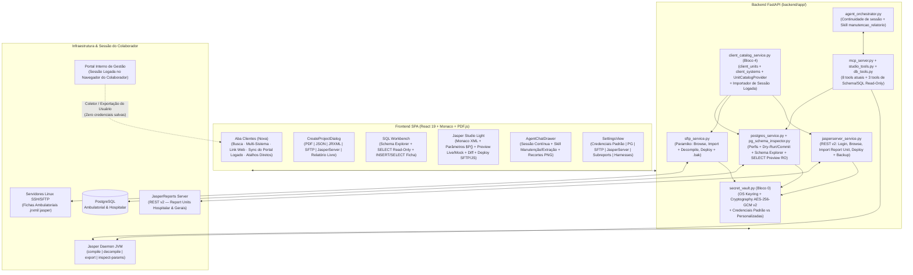
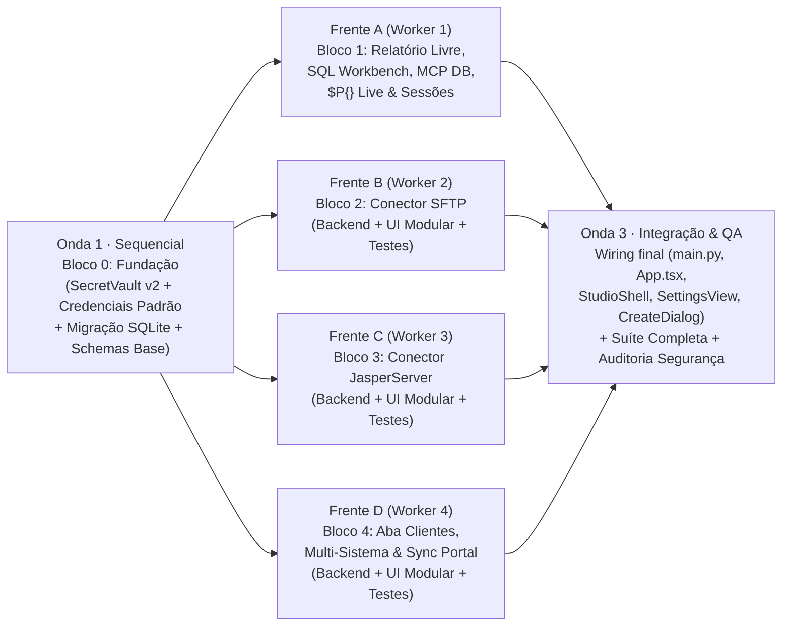

# Plano de Implementação & Estratégia — Salutem Ficha Studio `v1.1`

> **Data do planejamento:** 2026-11-27  
> **Branch / Baseline base:** `main` (`5ecc9a4` — `v1.0.0` + hardening, padronização de imports e Vite code-splitting)  
> **Propósito deste documento:** Servir como fonte única de verdade (contexto de negócio, decisões arquiteturais, especificações técnicas por bloco, estratégia de execução paralela com Swarm, regras de segurança e critérios de aceite).  
> **Regra de confidencialidade:** Este documento e o repositório **nunca** contêm URLs internas da empresa, nomes de clientes/unidades, endereços de servidores ou credenciais (padrão ou individuais). Todos os dados operacionais são configurados ou sincronizados localmente pelo usuário autenticado.

---

## 1. Contexto de Negócio & Origem da Evolução

### 1.1 Como o projeto nasceu (`v1.0.0`)
O **Salutem Ficha Studio** nasceu para resolver uma demanda intensa de criação de dezenas de fichas clínicas novas a partir de PDFs enviados por uma nova unidade de saúde do sistema **Salutem Ambulatorial**.

Antes do Studio, o fluxo era lento, fragmentado e mecânico:
1. Criar o layout do zero no **Jaspersoft Studio** (pesado, baseado em Eclipse);
2. Escrever e testar a query manualmente no **DataGrip**;
3. Cadastrar manualmente template, perguntas e respostas na interface web limitada do Salutem;
4. Mesmo com uso de IAs web, arquivos `.jrxml` grandes estouravam contexto/qualidade e a integração final (compilar, testar no ambiente da unidade, ajustar) continuava manual.

A `v1.0.0` resolveu esse fluxo ponta a ponta e já **eliminou na prática o uso de Jaspersoft Studio, DataGrip e cadastro manual de templates** para fichas novas a partir de PDF.

### 1.2 O problema estratégico pós-demanda
Quando a onda inicial de fichas novas dessa unidade acabar, a `v1.0.0` — presa exclusivamente ao fluxo linear `PDF → ficha.json → INSERT template_ficha_clinica → JRXML ambulatorial` — ficaria **específica demais** para o trabalho real do dia a dia da empresa:

- **Manutenção e ajustes rápidos** em relatórios e fichas existentes;
- **Relatórios complexos com SQL personalizado** e regras de negócio específicas (não vinculados a `template_ficha_clinica`);
- **Salutem Hospitalar** (mais complexo e muito usado na empresa): usa a mesma base tecnológica (**PostgreSQL + JasperReports + JasperReports Server**), porém com **schema de banco diferente** e publicação direta em **`Report Units`** no JasperReports Server;
- **Publicação manual em servidores**: hoje, para baixar, editar e substituir arquivos de fichas clínicas nos servidores ambulatoriais, o time ainda depende de **Tabby (SSH/SFTP)** ou **FileZilla**;
- **Gestão fragmentada de clientes e ambientes**: cada cliente/unidade pode possuir **múltiplos sistemas** (ex.: Ambulatorial e Hospitalar, ou HML e PRD), com links web, bancos PostgreSQL, JasperServer e SSH/SFTP distintos, hoje consultados manualmente no portal interno de gestão.

### 1.3 O gargalo organizacional (por que o produto tem alto valor na empresa)
- **Aproximadamente metade de todo o setor de TI** precisa mexer em relatórios quando a operação aperta, mas **não domina o Jaspersoft Studio** (pois atua em outras frentes no dia a dia), travando e precisando interromper especialistas com frequência.
- Colegas que já viram e testaram o Studio pela rede local reconheceram valor real e potencial de adoção (um ponto de atenção observado em teste real: colegas fiéis ao **Claude** relutaram em migrar quando só o harness `agy` estava configurado na máquina host).
- **Direcionamento de longo prazo:** transformar o Studio na ferramenta interna mais produtiva possível para democratizar criação e manutenção de relatórios (Ambulatorial + Hospitalar), criando alavancagem concreta para evoluir tecnicamente/estrategicamente na empresa (ex.: frente ou setor dedicado a ferramentas internas e IA aplicada).

---

## 2. Decisões Estratégicas & Escopo Fechado

| Decisão | Escolha Definida | Justificativa ("Por quê?") |
| :--- | :--- | :--- |
| **Posicionamento do produto** | **AI-First Report & Form Workbench** (NÃO clone visual drag-and-drop do Jaspersoft Studio) | Competir replicando 20 anos de painéis visuais do Eclipse/Jaspersoft é armadilha. O diferencial imbatível do Studio é **leveza, velocidade (~150ms), zero fricção e IA integrada com visão (PNGs) + acesso seguro ao schema do banco**. Para 5–10% de casos extremos, o `.jrxml` continua 100% padrão e interoperável. |
| **Foco da `v1.1`** | **100% utilidade diária**: Relatório Livre + SQL Workbench/MCP + SFTP + JasperReports Server `Report Unit` + **Aba de Clientes (Multi-Sistema)** + **Credenciais Padrão/Personalizadas** + Sessão Contínua | Cobre **Ambulatorial E Hospitalar** imediatamente, organiza todos os clientes/sistemas num único lugar e elimina 4 ferramentas pesadas/manuais: ~~Jaspersoft Studio~~, ~~DataGrip~~, ~~cadastro manual~~ e ~~FileZilla / Tabby~~. |
| **Contas multiusuário / Login (`STUDIO_AUTH_ENABLED`)** | **Adiado por tempo indeterminado** | Não investir esforço em burocracia de autenticação/usuários/papéis agora; todo foco vai para utilidade técnica real. Volta ao escopo apenas quando houver demanda formal de servidor compartilhado pela empresa. |
| **Aba de Clientes & Sincronização do Portal de Gestão** | **Incluída na `v1.1` (zero dados built-in no código/GitHub)** | Cada colaborador sincroniza os clientes sob demanda usando sua **própria sessão autenticada no navegador** (via coletor Bookmarklet/Snippet ou importação de JSON/HTML da página logada). A URL do portal é configurada localmente pelo usuário em `app_settings`. Nenhum dado interno ou credencial vai para o GitHub. |
| **Credenciais Padrão vs Personalizadas** | **Herança por tipo de conexão (`postgres`, `sftp`, `jasperserver`) no Cofre Local** | Como bancos e serviços corporativos frequentemente compartilham um usuário/senha padrão com exceções pontuais, o usuário cadastra uma única vez suas credenciais padrão no **Cofre Local (`SecretVault`)** e escolhe `credential_mode = 'default' | 'custom'` em cada perfil. Se a senha padrão mudar, atualiza em 1 lugar. **Nunca built-in no programa.** |
| **Múltiplos Sistemas por Cliente + Link Web** | **Relação 1:N (`client_units` → `client_systems`)** | Uma mesma unidade/cliente pode ter mais de um sistema (ex.: Ambulatorial + Hospitalar, HML + PRD), cada qual com seu `system_url` (atalho web clicável) e vínculos opcionais para PostgreSQL, SFTP e JasperServer. |
| **Integração JasperReports Server** | **Portar contratos validados do repo `fernandocalisto/jasper-reports-tools`** | O autor já validou em produção/homologação a API REST v2 do JasperServer da empresa em `src/services/jasperServerClient.ts` (login `POST /rest_v2/login`, `JSESSIONID` + Basic fallback, `username\|organization`, `serverInfo`, `resources`, resolução de `reportUnit` → `_files/main_jrxml`, `PUT` com `overwrite=true`). |
| **Cobertura Ambulatorial vs Hospitalar** | **Unified Remote Report Flow**: SFTP (fichas ambulatoriais) + JasperServer (Hospitalar e relatórios gerais ambulatoriais) | Reflete exatamente como a empresa opera nos dois produtos. |

---

## 3. Baseline Técnico Atual (Pós-`5ecc9a4`)

O repositório já possui uma base sólida e testada:

- **Backend (`backend/app/`)**: Python 3.11+ + FastAPI + SQLite WAL (`backend/app/db/sqlite_store.py`) + `psycopg` 3 + `pymupdf` + `keyring` + servidor MCP stdio próprio (`backend/app/mcp_tools/mcp_server.py`) com 8 ferramentas determinísticas + 4 harnesses (`agy`, `claude`, `codex`, `opencode`).
- **Frontend (`frontend/src/`)**: React 19 + TypeScript + Vite 6 (com `manualChunks` e proxy `/api` com `ws: true`) + Tailwind v4 + Monaco Editor + `@dnd-kit` + `pdfjs-dist` v5.
- **Jasper Daemon JVM (`java-engine/` → `resources/bin/jasper-daemon.jar`)**: Java 17+ + JasperReports `6.21.3` em modo HTTP residente `127.0.0.1` (`--action serve`) com suporte já existente a `compile`, `decompile`, `export`, `inspect-params`, `inspect-query` e `test-conn`.
- **Hardening recente (`c22d778`)**: CORS configurável via `STUDIO_CORS_ORIGINS` (padrão restrito a `localhost`/`127.0.0.1`), rejeição de chaves placeholder no cofre, CI com menor privilégio (`contents: read` global; `contents: write` só em `release`), imports padronizados em `backend.app.*`.
- **Nota de ambiente local**: em clones novos, criar `.venv` (`pip install -r backend/requirements.txt`) e instalar `frontend/node_modules` (`npm --prefix frontend ci`) antes de rodar a suíte baseline.

---

## 4. Arquitetura-Alvo da `v1.1`



---

## 5. Especificação Detalhada dos Blocos da `v1.1` (Organizados para Execução Paralela com Swarm)

> **Por que existe um Bloco 0?**  
> Para permitir que os **Blocos 1, 2, 3 e 4 sejam desenvolvidos em paralelo por workers independentes do Swarm sem conflitos de merge**, a fundação compartilhada (Cofre AES-256-GCM + Credenciais Padrão/Personalizadas + Migração SQLite v1.1 + contratos base) é consolidada primeiro no **Bloco 0**.

---

### Bloco 0 — Fundação Compartilhada (Pré-requisito Curto para o Fan-Out do Swarm)

**Objetivo técnico:** Unificar o cofre criptografado com suporte a credenciais padrão vs personalizadas e realizar a migração de banco/schemas uma única vez antes de abrir as 4 frentes paralelas.

#### 0.1 Cofre Unificado com `cryptography` (`backend/app/services/secret_vault.py`)
- Adicionar `cryptography>=43.0.0` (e `paramiko>=3.5.0` já previsto para o Bloco 2) em `backend/requirements.txt`.
- Extrair `_EncryptedVault` e o acesso a `keyring` de `postgres_service.py` para `SecretVaultService` reutilizado por `PostgresService`, `SftpService` e `JasperServerService`:
  - Novas gravações no `.vault.json` usam **`version: 2`** com **PBKDF2-HMAC-SHA256 (600.000 iterações) + AES-256-GCM** (autenticando `account` como AAD).
  - Leitura continua suportando entradas legadas **`version: 1`** (da `v1.0.0`) de forma transparente, migrando automaticamente para `v2` ao regravar.
  - Em Windows local, continua usando `keyring` (Windows Credential Manager) como primário e `.vault.json` como fallback (Docker/headless).
  - Mantém rejeição de chaves placeholder inseguras.

#### 0.2 Serviço de Credenciais Padrão vs Personalizadas (`backend/app/services/default_credentials_service.py` + API em `api/credentials.py`)
- Permite ao usuário configurar localmente (**nunca built-in no código!**) um conjunto padrão de credenciais e defaults operacionais por tipo de conexão (`postgres`, `sftp`, `jasperserver`):
  - **PostgreSQL padrão**: `username` + `default_dbname` opcional (ex.: por tipo `ambulatorial` / `hospitalar` quando o portal informa apenas `host:port`) em `app_settings` + `password` no `SecretVault` (`default:postgres:password`).
  - **SFTP / SSH padrão**: `username` + `auth_type` (`password | private_key`) + `default_remote_base_dir` (pasta padrão das fichas nos servidores Linux, já que o portal exibe apenas `host:port`/usuário) + `password` / `private_key` / `passphrase` no `SecretVault` (`default:sftp:*`).
  - **JasperReports Server padrão**: `username` + `organization` (opcional) + `password` no `SecretVault` (`default:jasperserver:password`).
- Método único `resolve_credentials(kind, *, credential_mode, custom_username, profile_id, ...)`:
  - `credential_mode == 'default'`: usa o usuário do perfil se preenchido ou herda o padrão; busca senha/chave do cofre padrão (`default:<kind>:*`).
  - `credential_mode == 'custom'`: usa usuário/senha/chave exclusivos do perfil (`<kind>:<profile_id>:*`).
- Endpoints REST:
  - `GET /api/credentials/defaults` (retorna apenas metadados: `username`, `organization`, `auth_type`, `has_password`, `has_private_key`, `updated_at` — **nunca** segredos em texto plano);
  - `PUT /api/credentials/defaults/{kind}` (`kind` em `postgres | sftp | jasperserver`);
  - `DELETE /api/credentials/defaults/{kind}` (remove credencial padrão do cofre local).

#### 0.3 Migração Idempotente do SQLite (`backend/app/db/sqlite_store.py` + `schemas.py` + `postgres_service.py`)
- **`projects`** (migração segura sobre bancos `v1.0` existentes, recriando tabela em transação com `PRAGMA foreign_keys = OFF` para ampliar o `CHECK` de `entry_mode`):
  - `project_kind TEXT NOT NULL DEFAULT 'clinical_form'` (`'clinical_form' | 'free_report'`);
  - `entry_mode` ampliado para `'pdf' | 'json' | 'jrxml' | 'blank_report' | 'sftp_import' | 'jasperserver_import'`;
  - `source_origin_json TEXT NOT NULL DEFAULT '{}'` (origem remota SFTP/JasperServer para 1-click deploy);
  - `default_db_profile_id TEXT NULL`;
  - `client_system_id TEXT NULL` (vínculo opcional ao sistema de um cliente da Aba Clientes).
- **`db_profiles`** (migração `ALTER TABLE` idempotente):
  - `credential_mode TEXT NOT NULL DEFAULT 'custom'` (`'default' | 'custom'`, mantendo perfis v1.0 como `'custom'`);
  - `environment TEXT NOT NULL DEFAULT 'HML'` (`'DEV' | 'HML' | 'PRD'`).
- **Nova tabela `agent_sessions`**:
  ```sql
  CREATE TABLE IF NOT EXISTS agent_sessions (
      project_id TEXT NOT NULL REFERENCES projects(id) ON DELETE CASCADE,
      phase TEXT NOT NULL,
      harness_id TEXT NOT NULL,
      external_session_id TEXT NOT NULL,
      updated_at TEXT NOT NULL,
      PRIMARY KEY (project_id, phase, harness_id)
  );
  ```
- **Testes obrigatórios do Bloco 0**: `test_secret_vault.py` (v2 AES-256-GCM + retrocompatibilidade v1 + default credentials), `test_sqlite_migration_v1_to_v1_1.py` (migração sobre banco `v1.0` real preservando projetos, revisões, gates e chat).

---

### Frente A / Bloco 1 — Modo Relatório Livre + SQL Workbench & MCP de Schema + Parâmetros `$P{}` + Sessão Contínua

**Objetivo de negócio:** Permitir criar e dar manutenção em **qualquer relatório JasperReports** (Ambulatorial ou Hospitalar) com queries SQL complexas, sem depender do fluxo de ficha clínica (`ficha.json`/`INSERT`), substituindo o DataGrip para exploração de banco e tornando a iteração com IA muito mais rápida e precisa.

#### 1.1 Fluxo por `project_kind` (`workspace_service.py` + `api/projects.py`)
- `clinical_form`: mantém 100% do comportamento da v1.0 (`Overview → Form Builder → SQL & Banco → Jasper Studio`).
- `free_report`: ao abrir o projeto, vai direto para `jasper_studio` (ou `sql_db` em modo Workbench), oculta/marca como opcional o Form Builder e a aba `INSERT` de ficha clínica, e sincroniza bidirecionalmente a `<queryString>` do `.jrxml` com o artefato `sql_select` (*"Extrair query do JRXML ↔ Aplicar query no JRXML"*).

#### 1.2 SQL Workbench & Schema Explorer Read-Only (`backend/app/services/pg_schema_inspector.py` + `api/database.py`)
- Separar a introspecção em módulo dedicado `pg_schema_inspector.py` (mantendo `postgres_service.py` focado em perfis + Dry-Run/Commit).
- Todas as operações usam `BEGIN READ ONLY` + `SET LOCAL statement_timeout = '10000'` + `ROLLBACK` no `finally`:
  1. `list_schemas(profile_id) -> list[str]` (exclui `pg_catalog`, `information_schema`, prioriza `public`);
  2. `list_tables(profile_id, *, schema="public", search=None, limit=100) -> list[TableSummary]` (tabelas e views + contagem estimada via `pg_class.reltuples`);
  3. `describe_table(profile_id, *, schema="public", table) -> TableSchemaDetail` (colunas, `pg_type`, `java_class`, `is_nullable`, `default`, `PK` e `FK` com tabela/coluna destino);
  4. `preview_select_query(profile_id, sql_select, *, params=None, limit=50) -> SelectPreviewResult`:
     - Valida estritamente read-only (bloqueia `INSERT`, `UPDATE`, `DELETE`, `DROP`, `ALTER`, `TRUNCATE`, `CREATE`, `GRANT`, `REVOKE`, `DO $$`, múltiplos statements);
     - Substitui placeholders Jasper (`$P{nome}`, `${nome}`, `$P!{nome}` validado) usando parâmetros bindados do `psycopg`;
     - Envolve em `SELECT * FROM (<query>) AS _studio_preview LIMIT %s` (`1 <= limit <= 200`, padrão `50`);
     - Serializa tipos PostgreSQL (`date`/`datetime`/`Decimal`/`UUID`/`bytes`) de forma segura.
- Novos endpoints em `backend/app/api/database.py`:
  - `GET /api/db/profiles/{profile_id}/schemas`
  - `GET /api/db/profiles/{profile_id}/tables?schema=public&search=...&limit=100`
  - `GET /api/db/profiles/{profile_id}/tables/{table_name}?schema=public`
  - `POST /api/db/profiles/{profile_id}/preview-select`

#### 1.3 Novas Ferramentas MCP de Introspecção de Banco (`backend/app/mcp_tools/db_tools.py`)
Registrar 3 novas ferramentas read-only em `studio_tools.py` e `STUDIO_MCP_TOOL_NAMES` (`harnesses/base.py`):
1. `list_db_tables(profile_id=None, project_id=None, schema="public", search="", limit=50)`
2. `describe_db_table(table, schema="public", profile_id=None, project_id=None)`
3. `preview_db_select(sql_select, params=None, limit=10, profile_id=None, project_id=None)` (teto rígido de 20 linhas na tool para economizar contexto).
> **Segurança MCP:** `annotations = {"readOnlyHint": True, "destructiveHint": False, "idempotentHint": True, "openWorldHint": False}` — nunca permite escrita, independentemente do perfil.

#### 1.4 Parâmetros Dinâmicos `$P{...}` & Preview `db_live` (`backend/app/jrxml/parameters.py` + `api/jasper_preview.py`)
- Utilitário `extract_jrxml_parameters(jrxml_xml: str) -> list[JrxmlParameterInfo]` + `extract_jrxml_query(jrxml_xml)` / `replace_jrxml_query(jrxml_xml, new_sql)`:
  - Parseia `<parameter name="..." class="...">` e `<defaultValueExpression>`, marcando parâmetros de sistema (`SUBREPORT_DIR`, `caminho_relatorio`, `REPORT_*`) como `is_system=True`.
- Novo endpoint `GET /api/projects/{project_id}/jasper/parameters`.
- Estender `JasperPreviewRequest`:
  - `mode: Literal["auto", "offline", "db_hybrid", "db_live"] = "auto"`;
  - `report_params: dict[str, Any] = Field(default_factory=dict)`;
  - No modo **`db_live`**: executa o `.jrxml` **sem reescrever a query com CTE fictícia**, passando `db_url`/`db_user`/`db_pass` (resolvidos via `SecretVault`, respeitando `default`/`custom`) + `report_params` tipados (`Long`, `Integer`, `Date`, `Boolean`, `String`) direto para o **Jasper Daemon JVM**.

#### 1.5 Continuidade de Sessão dos Agentes & Skill `manutencao_relatorio`
- Nova skill embutida: `backend/app/skills/manutencao_relatorio/SKILL.md` (registrada em `studio_tools.py` e `/api/skills`).
  - Em projetos `project_kind == "free_report"`, o orquestrador seleciona `manutencao_relatorio` em vez de `gerador_jrxml`.
- Continuidade de sessão nos 4 harnesses (`resume_session_id: str | None = None` em `HarnessRunRequest`):
  - **AGY**: `--conversation <id>`;
  - **Claude Code**: `--resume <id>`;
  - **Codex**: `codex exec resume <id>`;
  - **OpenCode**: reutilizar `session_id`;
  - Fallback automático para sessão nova se a sessão salva expirar/falhar.
- Endpoint `DELETE /api/projects/{project_id}/agent/session?phase=...&harness_id=...` + botão **"Nova sessão"** no `AgentChatPanel`.

#### 1.6 UI da Frente A
- `CreateProjectDialog`: opção **"Relatório Livre / Manutenção"** com seletor opcional de Cliente/Sistema ou Perfil PostgreSQL padrão.
- `SqlDbView`: modo Workbench para `free_report` + painel lateral colapsável **Schema Explorer** + botão **"Executar Preview (READ ONLY · LIMIT 50)"** com grade de resultados + **"Sincronizar Query ↔ JRXML"**.
- `JasperStudioView`: modo **`Live (Banco Real)`** na `PreviewControlBar` + barra/popover de **Parâmetros `$P{...}`** persistidos por projeto em `localStorage`.
- `AgentChatPanel`: indicador de sessão ativa + botão **"Nova sessão"**.

---

### Frente B / Bloco 2 — Conector SSH/SFTP (Substitui Tabby / FileZilla para Fichas Ambulatoriais)

**Objetivo de negócio:** Listar, importar (incluindo decompilação automática de `.jasper`), editar com IA e publicar de volta fichas hospedadas em servidores Linux ambulatoriais — com diff e backup automático `.bak.<timestamp>` antes de sobrescrever.

#### 2.1 Modelo de Dados (`sftp_profiles`)
```sql
CREATE TABLE IF NOT EXISTS sftp_profiles (
    id TEXT PRIMARY KEY,
    name TEXT NOT NULL,
    host TEXT NOT NULL,
    port INTEGER NOT NULL DEFAULT 22,
    username TEXT NOT NULL DEFAULT '',
    auth_type TEXT NOT NULL DEFAULT 'password' CHECK (auth_type IN ('password', 'private_key')),
    credential_mode TEXT NOT NULL DEFAULT 'custom' CHECK (credential_mode IN ('default', 'custom')),
    remote_base_dir TEXT NOT NULL DEFAULT '/',
    environment TEXT NOT NULL DEFAULT 'HML' CHECK (environment IN ('DEV', 'HML', 'PRD')),
    read_only INTEGER NOT NULL DEFAULT 1,
    linked_db_profile_id TEXT NULL,
    created_at TEXT NOT NULL,
    updated_at TEXT NOT NULL
);
```
- Segredos personalizados no `SecretVault` (`sftp_password:<id>`, `sftp_key:<id>`, `sftp_passphrase:<id>`); quando `credential_mode='default'`, herda de `default:sftp:*`.
- Perfis `PRD` nascem com `read_only=True` por padrão.

#### 2.2 Serviço SFTP (`backend/app/services/sftp_service.py`) & API (`backend/app/api/sftp.py`)
- Conexão `paramiko.SSHClient()` com timeouts explícitos (`15s`), context manager e normalização POSIX contra *path traversal*.
- Operações:
  1. `test_connection(profile_id)` → testa SSH/SFTP, valida `remote_base_dir`, retorna latência e contagem de itens;
  2. `list_directory(profile_id, remote_path=None, search=None)` → lista diretórios, `.jrxml` e `.jasper` (indicando par `.jrxml`/`.jasper`);
  3. `import_report_to_project(profile_id, remote_path, ...)` → baixa `.jrxml` direto ou baixa `.jasper` e chama **`JasperDaemonService.decompile()`** automaticamente; cria projeto `free_report` com `entry_mode="sftp_import"` e `source_origin_json` (e opção de baixar subreports `.jasper` faltantes da mesma pasta);
  4. `prepare_deploy_preview(project_id, profile_id, remote_dir, base_filename, publish_mode="jrxml_only")` → bloqueia `read_only=True` (`403`), compila na JVM (bloqueia se falhar!), baixa remoto atual gerando `unified_diff` + SHA-256 e emite `deploy_token` de uso único. *(Padrão operacional confirmado: `jrxml_only`, mantendo opções `both` e `jasper_only` no seletor.)*
  5. `execute_deploy(project_id, deploy_token)` → valida token, cria backup remoto `<nome>.bak.<YYYYMMDD_HHMMSS>` + cópia local em `workspaces/<proj>/backups/`, faz upload atômico (`.studio_tmp` + `posix_rename` com fallback `put`) e registra auditoria.
- Endpoints:
  - `GET / POST / PUT / DELETE /api/sftp/profiles[/{profile_id}]`
  - `POST /api/sftp/profiles/{profile_id}/test`
  - `GET /api/sftp/profiles/{profile_id}/browse?path=...&search=...`
  - `POST /api/sftp/import`
  - `POST /api/projects/{project_id}/deploy/sftp/prepare`
  - `POST /api/projects/{project_id}/deploy/sftp/execute`

#### 2.3 UI da Frente B
- `SettingsView` → nova aba **Servidores SFTP** (CRUD com toggle `Credencial Padrão` vs `Personalizada`, senha vs chave privada, `DEV/HML/PRD`, `read_only`, botão Testar Conexão).
- `CreateProjectDialog` → aba **"Importar via SFTP"** (navegador de pastas, filtro, badge de decompilação automática de `.jasper`).
- `JasperStudioView` → botão **"Publicar no SFTP"** (modal em 2 etapas: Pré-validar JVM + Diff + Confirmação com aviso de `.bak`).

---

### Frente C / Bloco 3 — Conector JasperReports Server (`Report Unit` — Hospitalar & Relatórios Gerais)

**Objetivo de negócio:** Cobrir integralmente o **Salutem Hospitalar** e relatórios gerais hospedados no JasperReports Server, permitindo importar uma **`Report Unit`** completa em 1 clique, trabalhar com IA + SQL Workbench + Preview Live, e publicar de volta com diff e backup automático.

#### 3.1 Modelo de Dados (`jasperserver_profiles`)
```sql
CREATE TABLE IF NOT EXISTS jasperserver_profiles (
    id TEXT PRIMARY KEY,
    name TEXT NOT NULL,
    base_url TEXT NOT NULL,
    organization TEXT NOT NULL DEFAULT '',
    username TEXT NOT NULL DEFAULT '',
    credential_mode TEXT NOT NULL DEFAULT 'custom' CHECK (credential_mode IN ('default', 'custom')),
    default_folder_uri TEXT NOT NULL DEFAULT '/',
    environment TEXT NOT NULL DEFAULT 'HML' CHECK (environment IN ('DEV', 'HML', 'PRD')),
    read_only INTEGER NOT NULL DEFAULT 1,
    linked_db_profile_id TEXT NULL,
    created_at TEXT NOT NULL,
    updated_at TEXT NOT NULL
);
```
- Senha personalizada no `SecretVault` (`jasperserver_password:<id>`); quando `credential_mode='default'`, herda de `default:jasperserver:*`.

#### 3.2 Serviço REST v2 (`backend/app/services/jasperserver_service.py`) & API (`backend/app/api/jasperserver.py`)
Portando os contratos validados de `fernandocalisto/jasper-reports-tools` (`httpx.Client`):
- **Auth**: `POST {base_url}/rest_v2/login` (`j_username={user|org}`, `j_password`), cache de `JSESSIONID` em memória com fallback Basic Auth e re-login automático em `401`.
- **Diagnóstico**: `GET {base_url}/rest_v2/serverInfo` → `version`, `edition`, `build`.
- **Navegação**: `GET {base_url}/rest_v2/resources?folderUri={uri}&recursive=false&forceFullPage=true` (busca `q=...&recursive=true`, tipos `folder`, `reportUnit`, `jrxml`, `jasper`, `datasource`).
- **Inspeção & Importação de `Report Unit`**:
  - `GET {base_url}/rest_v2/resources{uri}` (`Accept: application/repository.reportUnit+json`) → `main_jrxml`, `dataSource`, `inputControls`, `resources` (`{uri}_files/*`).
  - Download de `main_jrxml` (+ fallback `.jasper` → `decompile()` via JVM) e resolução automática de **ambos os modelos de subreports**:
    1. **Subreports embutidos na unit (`{uri}_files/*`)**: baixados para `workspaces/<proj>/report_unit_resources/` e compilados (`.jrxml` → `.jasper`) via JVM Daemon;
    2. **Subreports compartilhados em pastas do repositório (`repo:/...`)**: detectados via parsing de `<subreportExpression>` no `main_jrxml`, baixados do caminho correspondente no JasperServer (`.jrxml` ou `.jasper`), compilados se necessário e disponibilizados para o preview local (mantendo o `main_jrxml` original intacto para deploy).
- **Publicação Segura (`PUT`)**:
  - **Atualizar existente**: compila na JVM → baixa remoto + diff + `deploy_token` → salva backup local `workspaces/<proj>/backups/jasperserver_<timestamp>_main.jrxml` → `PUT {base_url}/rest_v2/resources{main_jrxml_uri}?overwrite=true&createFolders=true` (`application/repository.file+json` em base64).
  - **Criar nova `Report Unit`**: `PUT {base_url}/rest_v2/resources{target_folder}/{slug}?overwrite=false&createFolders=true` (`application/repository.reportUnit+json`) com `jrxmlFile` + `dataSource` escolhido do servidor.
- Endpoints:
  - `GET / POST / PUT / DELETE /api/jasperserver/profiles[/{profile_id}]`
  - `POST /api/jasperserver/profiles/{profile_id}/test`
  - `GET /api/jasperserver/profiles/{profile_id}/resources?folder_uri=/&q=...`
  - `GET /api/jasperserver/profiles/{profile_id}/report-unit?uri=...`
  - `POST /api/jasperserver/import`
  - `POST /api/projects/{project_id}/deploy/jasperserver/prepare`
  - `POST /api/projects/{project_id}/deploy/jasperserver/execute`

#### 3.3 UI da Frente C
- `SettingsView` → aba **JasperReports Server** (CRUD com `Credencial Padrão` vs `Personalizada`, `organization`, `DEV/HML/PRD`, `read_only`, perfil PG vinculado e teste exibindo versão/edição).
- `CreateProjectDialog` → aba **"Importar do JasperServer"** (navegador + busca + prévia de recursos da `Report Unit`).
- `JasperStudioView` → botão **"Publicar no JasperServer"** (fluxo em 2 etapas: validação JVM + diff + confirmação).

---

### Frente D / Bloco 4 — Aba de Clientes (Multi-Sistema) + Sincronização via Portal Logado + UI de Credenciais Padrão

**Objetivo de negócio:** Centralizar todos os clientes/unidades e seus múltiplos sistemas (Ambulatorial, Hospitalar, HML/PRD) em uma **aba dedicada "Clientes"** no Studio, com links diretos para o sistema web, atalhos para SQL Workbench / SFTP / JasperServer, gestão de credenciais padrão vs personalizadas e sincronização segura a partir da sessão logada do colaborador no portal de gestão — **sem nenhum dado corporativo hardcoded no GitHub**.

#### 4.1 Modelo de Dados (`client_units`, `client_systems` e vínculos de perfis)
```sql
CREATE TABLE IF NOT EXISTS client_units (
    id TEXT PRIMARY KEY,
    external_id TEXT NULL,
    unit_code TEXT NOT NULL UNIQUE,
    name TEXT NOT NULL,
    hosting TEXT NOT NULL DEFAULT '',
    license_status TEXT NOT NULL DEFAULT '',
    notes TEXT NOT NULL DEFAULT '',
    tags_json TEXT NOT NULL DEFAULT '[]',
    integrations_json TEXT NOT NULL DEFAULT '[]',
    last_synced_at TEXT NULL,
    created_at TEXT NOT NULL,
    updated_at TEXT NOT NULL
);

CREATE TABLE IF NOT EXISTS client_systems (
    id TEXT PRIMARY KEY,
    client_unit_id TEXT NOT NULL REFERENCES client_units(id) ON DELETE CASCADE,
    system_key TEXT NOT NULL,
    label TEXT NOT NULL,
    system_type TEXT NOT NULL DEFAULT 'ambulatorial'
        CHECK (system_type IN ('ambulatorial', 'hospitalar', 'painel', 'compras', 'outro')),
    environment TEXT NOT NULL DEFAULT 'PRD'
        CHECK (environment IN ('DEV', 'HML', 'PRD')),
    system_url TEXT NOT NULL DEFAULT '',
    version_label TEXT NOT NULL DEFAULT '',
    db_profile_id TEXT NULL,
    sftp_profile_id TEXT NULL,
    jasperserver_profile_id TEXT NULL,
    metadata_json TEXT NOT NULL DEFAULT '{}',
    created_at TEXT NOT NULL,
    updated_at TEXT NOT NULL,
    UNIQUE (client_unit_id, system_key)
);
```
- **Modelagem alinhada à estrutura real do portal de gestão**:
  - Cada cliente pode ter **múltiplos sistemas e ambientes** no mesmo cadastro (`Ambulatorial`, `Hospitalar`, `Painel`, `Portal de Compras`, `Homologação`, `BASE NOVA`, etc.) — o ambiente (`HML` vs `PRD`) é inferido automaticamente do rótulo.
  - **PostgreSQL (`BD`)**: como o portal informa `Nome` + `host:port` (sem `dbname`), cada perfil criado suporta `dbname` herdado de `default_dbname` (configurável nas Credenciais Padrão) **e** ação **Listar Bancos (`pg_database`)** na UI para escolher o banco real em 1 clique!
  - **SSH / SFTP**: como o portal já exibe múltiplos acessos SSH com `Nome`, `host:port`, `usuário` e senha (mascarada), o importador oferece toggle opcional *"Importar senhas SSH no cofre local (modo custom)"* vs *"Usar credencial SSH padrão"*, herdando `default_remote_base_dir` configurável.
  - **JasperServer (`Jasper`)**: suporta 1 ou mais URLs por cliente vinculadas aos sistemas do cliente, usando `credential_mode='default'` por padrão.

#### 4.2 Serviço de Catálogo & Sincronização (`backend/app/services/client_catalog_service.py` + `backend/app/api/clients.py`)
- Protocolo plugável `UnitCatalogProvider` + schema normalizado `ClientCatalogPayload`:
  ```python
  class ClientSystemEntry(BaseModel):
      system_key: str
      label: str
      system_type: Literal["ambulatorial", "hospitalar", "painel", "compras", "outro"] = "ambulatorial"
      environment: Literal["DEV", "HML", "PRD"] = "PRD"
      system_url: str = ""
      version_label: str = ""
      postgres: dict[str, Any] | None = None      # label, host, port, dbname?, user?, credential_mode='default'
      sftp: dict[str, Any] | None = None          # label, host, port, remote_base_dir?, user?, password?, credential_mode
      jasperserver: dict[str, Any] | None = None  # label?, base_url, organization?, user?, credential_mode='default'

  class ClientUnitEntry(BaseModel):
      external_id: str | None = None
      unit_code: str
      name: str
      hosting: str = ""
      license_status: str = ""
      tags: list[str] = Field(default_factory=list)
      integrations: list[str] = Field(default_factory=list)
      systems: list[ClientSystemEntry] = Field(default_factory=list)
  ```
- **Fluxos de Sincronização (100% locais e sob demanda do usuário autenticado)**:
  1. **Coletor na Sessão Logada do Navegador (Bookmarklet / Snippet)**:
     - Roda na aba onde o colaborador já está logado no portal de gestão (URL configurada localmente pelo usuário em `app_settings`, **nunca** hardcoded no código);
     - Tenta primeiro capturar o JSON completo via endpoint interno da sessão autenticada (todos os clientes de uma vez, já que a paginação do portal é 100% client-side) **e** faz fallback automático lendo os cards renderizados do DOM (incluindo DNS, BD, SSH, Jasper e Versões);
     - Copia o JSON normalizado para a área de transferência ou baixa `.json` temporário para colar/importar no Studio.
  2. **Pré-visualização (`POST /api/clients/sync/preview`)**: aceita JSON normalizado, JSON bruto do portal ou HTML salvo da página, e devolve o **diff detalhado** (`to_create`, `to_update`, `unchanged`, contagem de sistemas/perfis e avisos) sem gravar nada ainda.
  3. **Aplicação idempotente (`POST /api/clients/sync/apply`)**: cria/atualiza `client_units`, `client_systems` e os respectivos `db_profiles`, `sftp_profiles` e `jasperserver_profiles`:
     - Perfis PG e JasperServer nascem com `credential_mode='default'` (herdando as credenciais padrão do cofre local — editável para `'custom'` a qualquer momento);
     - Perfis de `environment='PRD'` nascem **sempre** com `read_only=True`;
     - Vincula automaticamente `linked_db_profile_id` nos perfis SFTP e JasperServer correspondentes;
     - Nunca sobrescreve senhas personalizadas já configuradas pelo usuário em sincronizações futuras!
  4. **Descoberta de Databases PostgreSQL (`GET /api/db/profiles/{profile_id}/databases`)**: consulta `pg_database` em modo read-only conectando no banco de manutenção (`postgres`) quando o perfil ainda não tem `dbname` definido, facilitando completar o `dbname` em 1 clique.
  5. **CRUD manual completo** (`GET/POST/PUT/DELETE /api/clients` e `/api/clients/{unit_id}/systems`).

#### 4.3 UI da Frente D (`frontend/src/features/clients/` + `SettingsView`)
- **Nova aba de navegação superior `"Clientes"`** no `StudioShell` (ao lado de `"Projetos"`, sem exigir projeto aberto, `StudioSection = "clients"`):
  - Barra de busca rápida por nome/código/tag + filtros por tipo (`Ambulatorial`, `Hospitalar`) e ambiente (`DEV`, `HML`, `PRD`);
  - Cards expansíveis de **Clientes** listando cada **Sistema** da unidade com badges (`Ambulatorial`/`Hospitalar`, `PRD`/`HML`, `RO`) e ações em 1 clique:
    - **Abrir Sistema Web** (`system_url` em nova aba);
    - **Testar Conexões** (PG / SFTP / JasperServer daquele sistema);
    - **Novo Relatório Livre** já pré-vinculado ao banco daquele sistema;
    - **Importar do SFTP** ou **Importar do JasperServer** já pré-selecionando o perfil daquele sistema;
    - **Editar Credenciais** (alternar entre `Usar Credencial Padrão` ou definir `Credencial Personalizada` só para aquele sistema).
  - Botão **"Sincronizar do Portal"** → abre `ClientSyncDialog`:
    - Campo para a **URL do Portal de Gestão** (salva apenas localmente no `studio.db`, nunca hardcoded);
    - Guia visual simples com **Bookmarklet / Snippet copiável** para executar na aba onde o colaborador já está logado + área para colar JSON ou enviar arquivo `.json`/`.html` salvo da página;
    - Etapa de **Prévia / Diff** (*Novos / Atualizados / Sem alterações*) antes de confirmar a sincronização.
- **Nova aba `"Credenciais Padrão"`** em `SettingsView` (`DefaultCredentialsTab.tsx`):
  - Cards limpos para configurar/atualizar/limpar as credenciais padrão no cofre local para **PostgreSQL**, **JasperReports Server** e **SSH/SFTP** (com aviso explícito de que tudo fica apenas no cofre local da máquina).

---

## 6. Estratégia de Execução Paralela com Swarm

Para maximizar velocidade mantendo qualidade e evitando conflitos de merge, o desenvolvimento será executado em **3 ondas**:



### Fronteiras de Arquivos por Frente (Zero Conflito no Swarm)
- **Onda 1 (Coordenador — Bloco 0)**: `requirements.txt`, `secret_vault.py`, `default_credentials_service.py`, `api/credentials.py`, `sqlite_store.py`, `schemas.py`, `postgres_service.py` (integração `SecretVault` + `credential_mode`), `frontend/src/types/studio.ts` (tipos compartilhados).
- **Onda 2 (4 Workers em paralelo — workspaces isolados `share`)**:
  - **Worker A (`sql-free-report`)**: `pg_schema_inspector.py`, `mcp_tools/db_tools.py`, `jrxml/parameters.py`, `skills/manutencao_relatorio/SKILL.md`, `agent_orchestrator.py`, `harnesses/*`, `api/database.py`, `api/jasper_preview.py`, `features/sql-db/*`, `features/jasper-studio/*`, `features/agent-chat/*` + testes dedicados.
  - **Worker B (`sftp-connector`)**: `services/sftp_service.py`, `api/sftp.py`, `features/settings/SftpProfilesTab.tsx`, `features/sftp/*` (`SftpBrowser`, `SftpImportTab`, `SftpDeployModal`) + `test_sftp_service.py` e testes Vitest.
  - **Worker C (`jasperserver-connector`)**: `services/jasperserver_service.py`, `api/jasperserver.py`, `features/settings/JasperServerProfilesTab.tsx`, `features/jasperserver/*` (`JasperServerBrowser`, `JasperServerImportTab`, `JasperServerDeployModal`) + `test_jasperserver_service.py` e testes Vitest.
  - **Worker D (`clients-hub`)**: `services/client_catalog_service.py`, `api/clients.py`, `features/clients/*` (`ClientsView`, `ClientCard`, `ClientSyncDialog`, `ClientFormDialog`), `features/settings/DefaultCredentialsTab.tsx` + `test_client_catalog.py` e testes Vitest.
- **Onda 3 (Coordenador — Integração Final)**:
  - Conectar routers em `backend/app/main.py`, rotas MCP em `studio_tools.py`, métodos REST em `frontend/src/lib/api.ts`, aba `Clientes` em `StudioShell.tsx`/`App.tsx`, abas em `SettingsView.tsx` e `CreateProjectDialog.tsx`, botões de deploy em `JasperStudioView.tsx`.
  - Rodar verificação completa: `pytest`, `typecheck`, `vitest`, `vite build` e revisão de segurança.

---

## 7. Regras de Negócio & Segurança Inegociáveis

1. **Zero dados sensíveis ou corporativos no GitHub / código-fonte**: nenhuma URL de portal interno, nenhum nome/IP de cliente e nenhuma credencial (padrão ou personalizada) podem existir no código, testes ou documentação versionada.
2. **Zero regressão na `v1.0.0`**: todo o fluxo existente de criação de fichas ambulatoriais (`PDF → JSON → Form Builder → INSERT Dry-Run/Commit → SELECT → JRXML → Preview → ZIP`) deve continuar passando integralmente nos testes existentes.
3. **Proteção absoluta de bancos de produção**:
   - `SQL Workbench` (Schema Explorer + Preview `SELECT`) e as 3 novas MCP tools de banco **SEMPRE** rodam em `BEGIN READ ONLY` + `statement_timeout` + `LIMIT` rígido + `ROLLBACK`.
   - `INSERT` continua exigindo `read_only=False` + Dry-Run token SHA-256 válido.
4. **Proteção absoluta de servidores remotos (SFTP e JasperServer)**:
   - Perfis `PRD` nascem `read_only=True` por padrão (bloqueio HTTP `403` no backend, não apenas na UI).
   - **Nunca publicar `.jrxml` que não compila na JVM**: o passo `prepare` sempre executa compilação JVM antes de emitir `deploy_token`.
   - **Backup obrigatório antes de sobrescrever**: SFTP cria `<arquivo>.bak.<timestamp>` no servidor remoto + cópia local; JasperServer arquiva cópia local do XML remoto antes do `PUT`.
5. **Sigilo de credenciais**: senhas de PostgreSQL, SFTP, chaves privadas SSH, senhas do JasperServer e credenciais padrão **nunca** vão para o SQLite, **nunca** aparecem em logs/respostas HTTP e **nunca** são passadas no prompt dos agentes de IA.
6. **Isolamento do escopo de IA**: o agente recebe acesso apenas às ferramentas MCP read-only de schema/preview e às ferramentas de artefato do projeto — **nunca** tem ferramenta MCP para fazer `COMMIT` no banco nem `deploy` em SFTP/JasperServer.

---

## 8. Decisões Operacionais Confirmadas na Validação

1. **SFTP Ambulatorial (Bloco 2):** padrão de deploy definido como **`jrxml_only` (Só `.jrxml`)**, mantendo opções `both` (`.jrxml` + `.jasper`) e `jasper_only` no seletor para casos pontuais.
2. **JasperServer (Bloco 3):** suporte híbrido a **ambos os modelos de subreports** — embutidos em `{unit}_files/` e externos/compartilhados referenciados via `repo:/...` no `<subreportExpression>`.
3. **Portal de Gestão (Bloco 4):** estrutura inspecionada em modo somente leitura com sucesso:
   - Todos os clientes são carregados em uma única resposta JSON (paginação 100% client-side), permitindo captura completa em 1 clique pelo coletor na sessão logada do navegador (com fallback DOM);
   - Múltiplos sistemas (`Ambulatorial`, `Hospitalar`, `Painel`, `Portal de Compras`, `Homologação`, etc.) convivem dentro do mesmo card de cliente (blocos `Versões`, `DNS`, `SSH`, `BD`, `Jasper`, `Integrações`);
   - Como `BD` exibe apenas `Nome` + `host:port` (sem `dbname`) e `SSH` não exibe diretório remoto, as **Credenciais Padrão** incluem também `default_dbname` (por tipo) + descoberta automática via `pg_database` e `default_remote_base_dir` para SFTP;
   - **Zero** URLs corporativas, nomes de clientes ou credenciais são versionados no código ou neste plano.

---

## 9. Backlog Adiado (Pós-`v1.1` / Sob Demanda)

- **Contas multiusuário & Login (`STUDIO_AUTH_ENABLED=true`, papéis `admin`/`member`, trava otimista `409`)** — adiado por tempo indeterminado até haver demanda formal de servidor compartilhado.
- **BYOK simplificado (API Key Claude/OpenAI/Gemini)** na UI de Configurações.
- **Engenharia Reversa de `template_ficha_clinica` (PostgreSQL Ambulatorial → `ficha.json`)**.
- **UI de Regras OCR / Regex Customizadas** (`backend/app/core/custom_regex.py`).
- **Comparação visual lado a lado** (*PDF Original vs Preview Jasper*) e biblioteca de blocos JRXML reutilizáveis.
- **Atualização de Actions no CI** (`actions/*@v4` → versões Node 24).

---

## 10. Estratégia de Testes & Critérios de Aceite da `v1.1`

| Bloco | Novos Testes Obrigatórios | Critério de Aceite ("Pronto") |
| :--- | :--- | :--- |
| **Bloco 0 (Fundação)** | `test_secret_vault.py` (AES-256-GCM v2, leitura retrocompatível v1, tamper/placeholder, default vs custom), `test_sqlite_migration_v1_to_v1_1.py` (migração sobre banco v1.0 real). | Cofre unificado, credenciais padrão/personalizadas funcionando e migração v1.0 → v1.1 sem perda de dados. |
| **Bloco 1 (Frente A)** | `test_sql_workbench.py` (schemas, tables, PK/FK, bloqueio DDL/DML, timeout/limit), `test_db_mcp_tools.py` (3 tools via MCP stdio), `test_agent_sessions.py` (resume/reset), `test_jrxml_parameters.py`, testes Vitest para Schema Explorer e `$P{}`. | Criar `Relatório Livre`, explorar schema real, pedir query com `JOIN` à IA, testar `SELECT` read-only, rodar Preview `db_live` com `$P{}` e iterar na mesma sessão. |
| **Bloco 2 (Frente B)** | `test_sftp_service.py` (fake SFTP: browse, import `.jrxml`/`.jasper` + decompile JVM, `default` vs `custom`, bloqueio `read_only`, falha de compilação bloqueando deploy, `.bak.<timestamp>`, consumo único do `deploy_token`), Vitest para aba SFTP e modal de deploy. | Importar ficha real via SFTP, editar, compilar, ver diff e publicar de volta gerando `.bak` sem FileZilla/Tabby. |
| **Bloco 3 (Frente C)** | `test_jasperserver_service.py` (`httpx.MockTransport`: login `JSESSIONID` + Basic, `username\|org`, `serverInfo`, `resources`, `reportUnit` + `_files/*`, `default` vs `custom`, `read_only`, backup local + `PUT overwrite=true`), Vitest para aba JasperServer e modal de deploy. | Navegar num JasperServer, importar `Report Unit`, ajustar query/layout com IA + Preview Live e publicar de volta com diff + backup. |
| **Bloco 4 (Frente D)** | `test_client_catalog.py` (CRUD multi-sistema, `system_url`, sync preview/apply idempotente, `PRD` sempre `read_only=True`, preservação de credenciais custom, 0 dados hardcoded), Vitest para `ClientsView`, `ClientSyncDialog` e `DefaultCredentialsTab`. | Abrir aba **Clientes**, cadastrar credenciais padrão no cofre local, sincronizar clientes via sessão logada, abrir link web de sistemas Ambulatorial/Hospitalar e iniciar trabalho direto nos bancos/SFTP/JasperServer vinculados. |
| **Integração Final** | Suíte completa: `pytest` (123 baseline + novos), `npm --prefix frontend run typecheck`, `npm --prefix frontend test`, `npm --prefix frontend run build` + auditoria garantindo zero URLs/segredos corporativos no diff. | 100% dos testes verdes e bundle pronto para uso local/LAN/Docker. |
