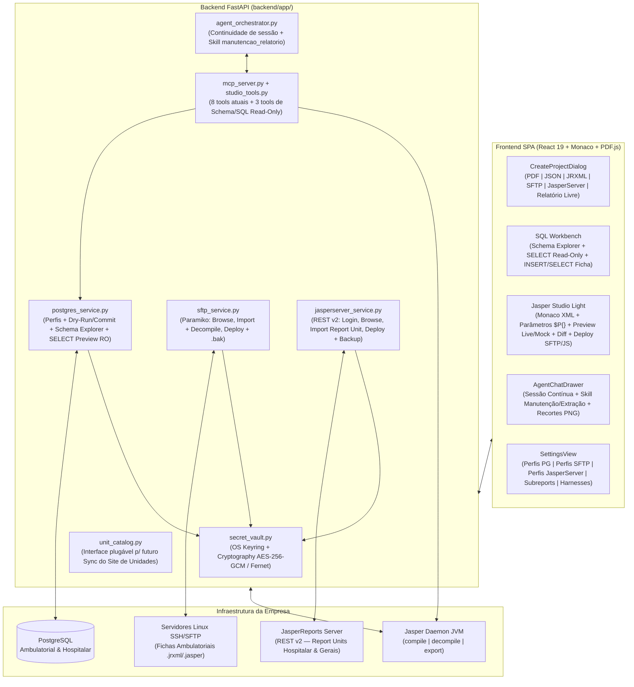

# Plano de Implementação & Estratégia — Salutem Ficha Studio `v1.1`

> **Data do planejamento:** 2026-11-27  
> **Branch / Baseline base:** `main` (`c22d778` — `v1.0.0` + quick wins de hardening, padronização de imports e Vite code-splitting)  
> **Propósito deste documento:** Servir como fonte única de verdade (contexto de negócio, decisões arquiteturais, especificações técnicas por bloco, regras de negócio e critérios de aceite) para continuidade do desenvolvimento em novas sessões ou em outro computador.

---

## 1. Contexto de Negócio & Origem da Evolução

### 1.1 Como o projeto nasceu (`v1.0.0`)
O **Salutem Ficha Studio** nasceu para resolver uma demanda intensa de criação de dezenas de fichas clínicas novas a partir de PDFs enviados por uma nova unidade de saúde do sistema **Salutem Ambulatorial**.

Antes do Studio, o fluxo era lento, fragmentado e mecânico:
1. Criar o layout do zero no **Jaspersoft Studio** (pesado, baseado em Eclipse);
2. Escrever e testar a query manualmente no **DataGrip**;
3. Cadastrar manualmente template, perguntas e respostas na interface web limitada do Salutem;
4. Mesmo com uso de IAs web, arquivos `.jrxml` grandes estouravam contexto/qualidade e a integração final (compilar, testar no ambiente da unidade, ajustar) continuava manual.

A `v1.0.0` resolveu esse fluxo ponta a ponta e já **eliminou na prática o uso de Jaspersoft Studio, DataGrip e cadastro manual de templates** para fichas novas a partir de PDF.

### 1.2 O problema estratégico pós-demanda
Quando a onda inicial de fichas novas dessa unidade acabar, a `v1.0.0` — presa exclusivamente ao fluxo linear `PDF → ficha.json → INSERT template_ficha_clinica → JRXML ambulatorial` — ficaria **específica demais** para o trabalho real do dia a dia da empresa:

- **Manutenção e ajustes rápidos** em relatórios e fichas existentes;
- **Relatórios complexos com SQL personalizado** e regras de negócio específicas (não vinculados a `template_ficha_clinica`);
- **Salutem Hospitalar** (mais complexo e muito usado na empresa): usa a mesma base tecnológica (**PostgreSQL + JasperReports + JasperReports Server**), porém com **schema de banco diferente** e publicação direta em **`Report Units`** no JasperReports Server;
- **Publicação manual em servidores**: hoje, para baixar, editar e substituir arquivos de fichas clínicas nos servidores ambulatoriais, o time ainda depende de **Tabby (SSH/SFTP)** ou **FileZilla**.

### 1.3 O gargalo organizacional (por que o produto tem alto valor na empresa)
- **Aproximadamente metade de todo o setor de TI** precisa mexer em relatórios quando a operação aperta, mas **não domina o Jaspersoft Studio** (pois atua em outras frentes no dia a dia), travando e precisando interromper especialistas com frequência.
- Colegas que já viram e testaram o Studio pela rede local reconheceram valor real e potencial de adoção (um ponto de atenção observado em teste real: colegas fiéis ao **Claude** relutaram em migrar quando só o harness `agy` estava configurado na máquina host).
- **Direcionamento de longo prazo:** transformar o Studio na ferramenta interna mais produtiva possível para democratizar criação e manutenção de relatórios (Ambulatorial + Hospitalar), criando alavancagem concreta para evoluir tecnicamente/estrategicamente na empresa (ex.: frente ou setor dedicado a ferramentas internas e IA aplicada).

---

## 2. Decisões Estratégicas & Escopo Fechado

| Decisão | Escolha Definida | Justificativa ("Por quê?") |
| :--- | :--- | :--- |
| **Posicionamento do produto** | **AI-First Report & Form Workbench** (NÃO clone visual drag-and-drop do Jaspersoft Studio) | Competir replicando 20 anos de painéis visuais do Eclipse/Jaspersoft é armadilha. O diferencial imbatível do Studio é **leveza, velocidade (~150ms), zero fricção e IA integrada com visão (PNGs) + acesso seguro ao schema do banco**. Para 5–10% de casos extremos, o `.jrxml` continua 100% padrão e interoperável. |
| **Foco da `v1.1`** | **100% utilidade diária** (Ordem 1): Relatório Livre + SQL Workbench/MCP + SFTP + JasperReports Server `Report Unit` + Sessão Contínua | Cobre **Ambulatorial E Hospitalar** imediatamente e elimina 4 ferramentas pesadas/manuais: ~~Jaspersoft Studio~~, ~~DataGrip~~, ~~cadastro manual~~ e ~~FileZilla / Tabby~~. |
| **Contas multiusuário / Login (`STUDIO_AUTH_ENABLED`)** | **Adiado por tempo indeterminado** | Não investir esforço em burocracia de autenticação/usuários/papéis agora; todo foco vai para utilidade técnica real. Volta ao escopo apenas quando houver demanda formal de servidor compartilhado pela empresa. |
| **Portal interno de gestão de unidades** | **Deixar interface plugável (`UnitCatalogProvider`), sem bloquear a `v1.1`** | Existe um site interno atualizado em tempo real com URLs de PostgreSQL (login padrão), JasperServer e SSH de todas as unidades. O formato de acesso (API vs HTML/auth) ainda será levantado com colegas; a arquitetura ficará pronta para plugar o sync sem refatorar o core. |
| **Integração JasperReports Server** | **Portar contratos validados do repo `fernandocalisto/jasper-reports-tools`** | O autor já validou em produção/homologação a API REST v2 do JasperServer da empresa em `src/services/jasperServerClient.ts` (login `POST /rest_v2/login`, `JSESSIONID` + Basic fallback, `username\|organization`, `serverInfo`, `resources`, resolução de `reportUnit` → `_files/main_jrxml`, `PUT` com `overwrite=true`). |
| **Cobertura Ambulatorial vs Hospitalar** | **Unified Remote Report Flow**: SFTP (fichas ambulatoriais) + JasperServer (Hospitalar e relatórios gerais ambulatoriais) | Reflete exatamente como a empresa opera nos dois produtos. |

---

## 3. Baseline Técnico Atual (Pós-`c22d778`)

O repositório já possui uma base sólida e testada:

- **Backend (`backend/app/`)**: Python 3.13 + FastAPI + SQLite WAL (`backend/app/db/sqlite_store.py`) + `psycopg` 3 + `pymupdf` + `keyring` + servidor MCP stdio próprio (`backend/app/mcp_tools/mcp_server.py`) com 8 ferramentas determinísticas + 4 harnesses (`agy`, `claude`, `codex`, `opencode`).
- **Frontend (`frontend/src/`)**: React 19 + TypeScript + Vite 6 (com `manualChunks` e proxy `/api` com `ws: true`) + Tailwind v4 + Monaco Editor + `@dnd-kit` + `pdfjs-dist` v5.
- **Jasper Daemon JVM (`java-engine/` → `resources/bin/jasper-daemon.jar`)**: Java 17 + JasperReports `6.21.3` em modo HTTP residente `127.0.0.1` (`--action serve`) com suporte já existente a `compile`, `decompile`, `export`, `inspect-query` e `test-conn`.
- **Hardening recente (`c22d778`)**: CORS configurável via `STUDIO_CORS_ORIGINS` (padrão restrito a `localhost`/`127.0.0.1`), rejeição de chaves placeholder no cofre, CI com menor privilégio (`contents: read` global; `contents: write` só em `release`), imports padronizados em `backend.app.*`.
- **Baseline de testes verdes**: **123 passed** no `pytest` (incl. JVM real e MCP stdio) e **11 arquivos / 49 passed** no `vitest`, `typecheck` com 0 erros e bundle `index-*.js` em 267 KB.

---

## 4. Arquitetura-Alvo da `v1.1`



---

## 5. Especificação Detalhada dos 4 Blocos da `v1.1`

> Os blocos foram desenhados para serem **incrementais e independentemente entregáveis**: ao final de cada bloco, o Studio já ganha novas capacidades usáveis em produção local e com testes 100% verdes.

---

### Bloco 1 — Modo Relatório Livre + SQL Workbench & MCP de Schema + Parâmetros Dinâmicos + Sessão Contínua

**Objetivo de negócio:** Permitir criar e dar manutenção em **qualquer relatório JasperReports** (Ambulatorial ou Hospitalar) com queries SQL complexas, sem depender do fluxo de ficha clínica (`ficha.json`/`INSERT`), substituindo o DataGrip para exploração de banco e tornando a iteração com IA muito mais rápida e precisa.

#### 1.1 Modelo de Projeto e Persistência (`sqlite_store.py` + `schemas.py`)
- **Estender `projects` sem quebrar projetos v1.0 existentes** (migração idempotente `ALTER TABLE` em `SQLiteStore.init_db()`):
  - `project_kind TEXT NOT NULL DEFAULT 'clinical_form'` (`CHECK` ou validação Pydantic: `'clinical_form' | 'free_report'`).
  - `source_origin_json TEXT NOT NULL DEFAULT '{}'` — guarda metadados da origem remota quando importado de SFTP ou JasperServer (ex.: `{"provider": "sftp", "profile_id": "...", "remote_path": "/.../ficha.jrxml"}` ou `{"provider": "jasperserver", "profile_id": "...", "resource_uri": "/reports/.../unit", "main_jrxml_uri": "..."}`), permitindo o botão **Deploy de volta para a origem** em 1 clique!
  - `default_db_profile_id TEXT NULL` — associa o projeto a um perfil PostgreSQL preferencial (ex.: banco Hospitalar X ou Ambulatorial Y) para que o SQL Workbench, o Preview Live e as MCP tools saibam qual banco consultar sem o usuário reselecionar toda hora.
- **Expandir `EntryMode`** em `backend/app/db/schemas.py` e `frontend/src/types/studio.ts`:
  - De `Literal["pdf", "json", "jrxml"]` para `Literal["pdf", "json", "jrxml", "blank_report", "sftp_import", "jasperserver_import"]`.
  - **Importante sobre SQLite `CHECK` constraints:** como `projects.entry_mode` atual possui `CHECK (entry_mode IN ('pdf', 'json', 'jrxml'))` em `sqlite_store.py`, a migração precisará recriar a tabela `projects` de forma segura (padrão SQLite `CREATE TABLE projects_new ... INSERT INTO ... DROP ... RENAME`) com `PRAGMA foreign_keys = OFF` dentro de transação, ou remover o `CHECK` rígido de `entry_mode` mantendo a validação na camada Pydantic. *Testar explicitamente a migração sobre um banco `studio.db` v1.0 existente!*
- **Nova tabela `agent_sessions`** em `sqlite_store.py`:
  ```sql
  CREATE TABLE IF NOT EXISTS agent_sessions (
      project_id TEXT NOT NULL REFERENCES projects(id) ON DELETE CASCADE,
      phase TEXT NOT NULL,
      harness_id TEXT NOT NULL,
      external_session_id TEXT NOT NULL,
      updated_at TEXT NOT NULL,
      PRIMARY KEY (project_id, phase, harness_id)
  );
  ```
- **Comportamento de fluxo por `project_kind`**:
  - `clinical_form`: mantém 100% do comportamento da v1.0 (`Overview → Form Builder → SQL & Banco → Jasper Studio`).
  - `free_report`: ao abrir o projeto, vai direto para `jasper_studio` (ou `sql_db` em modo Workbench), **oculta/marca como opcional** o Form Builder e a aba `INSERT` de ficha clínica, e permite editar diretamente a `<queryString>` do `.jrxml` sincronizada com o artefato `sql_select` (botão bidirecional *"Extrair query do JRXML ↔ Aplicar query no JRXML"*).

#### 1.2 SQL Workbench & Schema Explorer Read-Only (`postgres_service.py` + `api/database.py`)
- **Novos métodos em `PostgresService`** (sempre usando transação explícita `SET TRANSACTION READ ONLY` + `ROLLBACK` no `finally` + `SET LOCAL statement_timeout = '10000'`):
  1. `list_schemas(profile_id) -> list[str]`: lista schemas não-sistema (`pg_catalog`, `information_schema` excluídos por padrão, priorizando `public`).
  2. `list_tables(profile_id, *, schema: str = "public", search: str | None = None, limit: int = 100) -> list[TableSummary]`: consulta `information_schema.tables` (tabelas e views) com filtro `ILIKE` por nome e contagem estimada de linhas (`pg_class.reltuples`).
  3. `describe_table(profile_id, *, schema: str = "public", table: str) -> TableSchemaDetail`: retorna colunas (`name`, `data_type`, `udt_name`, `is_nullable`, `default`, `java_class`), chaves primárias (`PK`) e chaves estrangeiras (`FK` apontando para tabela/coluna destino) — essencial para a IA e o analista montarem `JOIN`s corretos tanto no Ambulatorial quanto no Hospitalar!
  4. `preview_select_query(profile_id, sql_select: str, *, params: dict[str, Any] | None = None, limit: int = 50) -> SelectPreviewResult`:
     - Valida estritamente que a query é somente leitura (rejeita `INSERT`, `UPDATE`, `DELETE`, `DROP`, `ALTER`, `TRUNCATE`, `CREATE`, `GRANT`, `REVOKE`, `DO $$`, múltiplos statements separados por `;`).
     - Substitui placeholders Jasper (`$P{nome}`, `$P!{nome}` apenas se seguro/validado, `${nome}`) usando parâmetros bindados do `psycopg` quando possível.
     - Envolve em `SELECT * FROM (<query>) AS _studio_preview LIMIT %s` com teto rígido (`1 <= limit <= 200`, padrão `50`).
     - Executa dentro de `BEGIN READ ONLY` com `statement_timeout = 10s` e sempre executa `ROLLBACK`.
     - Retorna `columns` (nome + `pg_type` + `java_class`), `rows` (serializadas em JSON seguro: `date`/`datetime`/`Decimal`/`UUID`/`bytes` convertidos limpos), `row_count`, `truncated: bool`, `latency_ms`.
- **Novos endpoints em `backend/app/api/database.py`**:
  - `GET /api/db/profiles/{profile_id}/schemas`
  - `GET /api/db/profiles/{profile_id}/tables?schema=public&search=...&limit=100`
  - `GET /api/db/profiles/{profile_id}/tables/{table_name}?schema=public`
  - `POST /api/db/profiles/{profile_id}/preview-select`

#### 1.3 Novas Ferramentas MCP de Introspecção de Banco (`backend/app/mcp_tools/`)
Criar `backend/app/mcp_tools/db_tools.py` e registrar 3 novas ferramentas read-only em `studio_tools.py` e `STUDIO_MCP_TOOL_NAMES` (`base.py`):
1. `list_db_tables(profile_id: str | None = None, project_id: str | None = None, schema: str = "public", search: str = "", limit: int = 50)` — resolve `profile_id` diretamente ou pelo `default_db_profile_id` do projeto (ou perfil default do Studio).
2. `describe_db_table(table: str, schema: str = "public", profile_id: str | None = None, project_id: str | None = None)` — devolve colunas, tipos, PKs e FKs para a IA montar `JOIN`s sem alucinar.
3. `preview_db_select(sql_select: str, params: dict | None = None, limit: int = 10, profile_id: str | None = None, project_id: str | None = None)` — permite à IA testar sua própria query real contra o PostgreSQL em modo `READ ONLY` (máx. 20 linhas na tool para economizar contexto) e verificar colunas + amostra de dados antes de gravar no `.jrxml`!

> **Regra de segurança MCP:** todas as 3 tools têm `annotations = {"readOnlyHint": True, "destructiveHint": False, "idempotentHint": True, "openWorldHint": False}` e **nunca** permitem escrita no banco, independentemente do perfil ser `read_only` ou não.

#### 1.4 Parâmetros Dinâmicos `$P{...}` no Preview Live (`api/jasper_preview.py` + `jrxml/`)
- Criar utilitário `extract_jrxml_parameters(jrxml_xml: str) -> list[JrxmlParameterInfo]` em `backend/app/jrxml/`:
  - Parseia todos os `<parameter name="..." class="...">` + `<defaultValueExpression>` do `.jrxml`, ignorando parâmetros internos/sistema (`SUBREPORT_DIR`, `caminho_relatorio`, `REPORT_*`) ou marcando-os como `is_system=True`.
- Novo endpoint `GET /api/projects/{project_id}/jasper/parameters` (ou incluir na resposta de `/compile` e `/artifacts/jrxml`).
- Estender `JasperPreviewRequest` em `backend/app/api/jasper_preview.py`:
  - Adicionar `mode: Literal["auto", "offline", "db_hybrid", "db_live"] = "auto"`.
  - Adicionar `report_params: dict[str, Any] = Field(default_factory=dict)`.
  - No novo modo **`db_live`**: executa o `.jrxml` **sem reescrever a query com CTE fictícia**, passando `db_url`/`db_user`/`db_pass` do perfil PostgreSQL + `report_params` (convertidos para o tipo esperado: `Long`, `Integer`, `Date`, `Boolean`, `String`) diretamente para o **Jasper Daemon JVM**!
  - Isso permite testar relatórios complexos do **Hospitalar e JasperServer** com dados reais de homologação/produção (somente leitura) em 150ms!

#### 1.5 Continuidade de Sessão dos Agentes & Nova Skill `manutencao_relatorio`
- **Nova skill embutida:** `backend/app/skills/manutencao_relatorio/SKILL.md`:
  - Registrada em `studio_tools.py` (`get_salutem_skill`) e `api/harnesses_and_tools.py` (`/api/skills`).
  - Focada em: ajustes cirúrgicos em `.jrxml` existentes (preservando estrutura/estilo original sem reescrever tudo do zero), relatórios livres do JasperServer (Ambulatorial e Hospitalar), construção/otimização de queries SQL complexas usando `list_db_tables` → `describe_db_table` → `preview_db_select`, e validação via `validate_and_compile_jrxml` + `render_preview_images`.
  - Em projetos `project_kind == "free_report"`, o orquestrador carrega automaticamente `manutencao_relatorio` em vez de `gerador_jrxml` (que é específico de fichas ambulatoriais com 36 fields fixos e header de 182px).
- **Continuidade de sessão nativa nos 4 harnesses**:
  - Adicionar `resume_session_id: str | None = None` em `HarnessRunRequest` (`backend/app/harnesses/types.py`).
  - Capturar `session_id` / `conversation_id` / `thread_id` dos eventos retornados pelo CLI e emiti-lo em `DONE.metadata["session_id"]`:
    - **AGY**: capturar `conversation_id` do stream JSON e passar `--conversation <id>` nos turnos seguintes;
    - **Claude Code**: capturar `session_id` do evento `system`/`result` e passar `--resume <id>`;
    - **Codex**: capturar `thread_id` e usar `codex exec resume <id> ...`;
    - **OpenCode**: reutilizar `session_id` existente no servidor/CLI.
  - Em caso de falha ao retomar sessão expirada/inválida, limpar `agent_sessions` e fazer fallback automático para sessão nova sem travar o usuário.
  - Novo endpoint `DELETE /api/projects/{project_id}/agent/session?phase=...&harness_id=...` + botão **"Nova sessão"** no `AgentChatPanel`.

#### 1.6 UI do Bloco 1 (`frontend/src/`)
- **`CreateProjectDialog`**: nova opção destacada **"Relatório Livre / Manutenção"** (além de PDF, JSON, JRXML) com seletor opcional de Perfil PostgreSQL padrão.
- **`SqlDbView`**:
  - Em `free_report`, foca na aba **SQL Workbench** (esconde o bloco `INSERT` de ficha clínica ou recolhe como secundário);
  - Novo painel lateral colapsável **Schema Explorer** (busca de tabelas → clique expande colunas, tipos, PK/FK + botão copiar nome/gerar `SELECT` base);
  - Botão **"Executar Preview (READ ONLY · LIMIT 50)"** com grade de resultados limpa (colunas, tipos Java, contagem e tempo em ms);
  - Botão **"Sincronizar Query ↔ JRXML"** para puxar `<queryString>` do `.jrxml` para o editor SQL ou atualizar a `<queryString>` do `.jrxml` com o SQL validado.
- **`JasperStudioView`**:
  - Na `PreviewControlBar`, suportar modo **`Live (Banco Real)`** ao lado de `Auto` / `Offline` / `Híbrido CTE`;
  - Popover/barra de **Parâmetros do Relatório (`$P{...}`)** gerada dinamicamente a partir do XML, persistindo os últimos valores usados por projeto em `localStorage`.
- **`AgentChatPanel`**: indicador sutil de sessão ativa + botão **"Nova sessão"** para limpar contexto do harness quando trocar de assunto.

---

### Bloco 2 — Conector SSH/SFTP (Substitui Tabby / FileZilla para Fichas Ambulatoriais)

**Objetivo de negócio:** Permitir listar, importar (incluindo decompilação automática de `.jasper`!), editar com IA e publicar de volta os relatórios de fichas clínicas hospedados em pastas dos servidores Linux ambulatoriais — com diff e backup automático `.bak` antes de sobrescrever.

#### 2.1 Dependência & Modelo de Dados
- Adicionar `paramiko>=3.5.0` em `backend/requirements.txt`.
- Nova tabela `sftp_profiles` em SQLite (criada via `SftpService` no padrão de `db_profiles`):
  ```sql
  CREATE TABLE IF NOT EXISTS sftp_profiles (
      id TEXT PRIMARY KEY,
      name TEXT NOT NULL,
      host TEXT NOT NULL,
      port INTEGER NOT NULL DEFAULT 22,
      username TEXT NOT NULL,
      auth_type TEXT NOT NULL DEFAULT 'password' CHECK (auth_type IN ('password', 'private_key')),
      remote_base_dir TEXT NOT NULL DEFAULT '/',
      environment TEXT NOT NULL DEFAULT 'HML' CHECK (environment IN ('DEV', 'HML', 'PRD')),
      read_only INTEGER NOT NULL DEFAULT 1,
      linked_db_profile_id TEXT NULL,
      created_at TEXT NOT NULL,
      updated_at TEXT NOT NULL
  );
  ```
  - **Segredos no cofre (`SecretVault`)**: senha (`sftp_password:<id>`), conteúdo PEM da chave privada (`sftp_key:<id>`) e passphrase opcional (`sftp_passphrase:<id>`). **Nunca** armazenados no SQLite nem retornados pela API (apenas `has_secret: bool`).
  - **Segurança padrão**: perfis criados com `environment='PRD'` vêm com `read_only=True` por padrão na UI.

#### 2.2 Serviço SFTP (`backend/app/services/sftp_service.py`)
- **Conexão segura e limpa**: `paramiko.SSHClient()` com timeouts explícitos (`timeout=15`, `banner_timeout=15`), fechamento garantido via context manager, proteção contra *path traversal* (normalização POSIX `posixpath.normpath` impedindo escapar de `remote_base_dir` se configurado como raiz restrita, ou permitindo navegar quando `remote_base_dir='/'`).
- **Operações principais**:
  1. `test_connection(profile_id) -> SftpConnectionTestResult`: testa SSH + abertura de canal SFTP, valida existência de `remote_base_dir`, retorna latência e contagem de itens.
  2. `list_directory(profile_id, remote_path: str | None = None, search: str | None = None) -> SftpListResult`: lista pastas e arquivos (`.jrxml`, `.jasper`, outros) com `size_bytes`, `modified_at`, `is_dir`, e indicação se existe par `.jrxml`/`.jasper` no mesmo diretório.
  3. `import_report_to_project(profile_id, remote_path: str, *, project_name: str | None = None, db_profile_id: str | None = None, sync_subreports: bool = False) -> SftpImportResult`:
     - Se `remote_path` termina com `.jrxml`: baixa o XML UTF-8 diretamente.
     - Se `remote_path` termina com `.jasper`: baixa o binário temporariamente e chama **`JasperDaemonService.decompile()`** (já existente no `java-engine`!) para obter o `.jrxml` editável automaticamente!
     - Cria (ou atualiza) um projeto `project_kind="free_report"` (ou vincula a um projeto existente) com `entry_mode="sftp_import"` e grava `source_origin_json` com `profile_id` + `remote_path`.
     - Opcionalmente detecta referências `<subreportExpression>` no XML e oferece baixar os `.jasper` faltantes da mesma pasta remota para `custom_subreports` (ou pasta do projeto).
  4. `prepare_deploy_preview(project_id, profile_id, remote_dir: str, base_filename: str, *, publish_mode: Literal["both", "jasper_only", "jrxml_only"] = "both") -> SftpDeployPreview`:
     - **Pré-checagem obrigatória**:
       - Bloqueia imediatamente com HTTP `403` se perfil estiver `read_only=True`.
       - Compila o `.jrxml` atual na **Jasper Daemon JVM** (`compile`) — **não permite deploy de XML que não compila!**
       - Se já existir `.jrxml` remoto no destino, baixa e gera um **diff unificado** (`difflib.unified_diff`) + SHA-256 remoto vs local.
       - Emite um **token de deploy** (`deploy_token` atrelado a `project_id + profile_id + remote_path + jrxml_sha256`, análogo ao Dry-Run token do PostgreSQL!).
  5. `execute_deploy(project_id, deploy_token: str, ...) -> SftpDeployResult`:
     - Valida `read_only=False` e `deploy_token` válido e não consumido.
     - Para cada arquivo alvo (`.jrxml` e/ou `.jasper` conforme `publish_mode`):
       - Se o arquivo remoto já existir, **cria backup automático no servidor remoto** antes de substituir (ex.: copia/renomeia para `<nome>.bak.<YYYYMMDD_HHMMSS>` ou pasta `_studio_backups/` configurável — mantendo também cópia do original remoto no `workspaces/<proj>/backups/` local!).
       - Faz upload atômico via arquivo temporário `.studio_tmp` + `posix_rename` (ou fallback `put` se o SFTP server não suportar `posix_rename`), preservando permissões se possível.
     - Registra evento de auditoria no histórico do projeto (timestamp, perfil, caminho remoto, arquivos publicados, caminho do backup).

#### 2.3 Endpoints REST (`backend/app/api/sftp.py`)
- `GET / POST / PUT / DELETE /api/sftp/profiles[/{profile_id}]`
- `POST /api/sftp/profiles/{profile_id}/test`
- `GET /api/sftp/profiles/{profile_id}/browse?path=...&search=...`
- `POST /api/sftp/import` (cria projeto a partir de `.jrxml`/`.jasper` remoto)
- `POST /api/projects/{project_id}/deploy/sftp/prepare` (compila + diff + emite `deploy_token`)
- `POST /api/projects/{project_id}/deploy/sftp/execute` (backup `.bak` + upload + log)

#### 2.4 UI do Bloco 2
- **`SettingsView`**: nova aba **Servidores SFTP** (CRUD de perfis, toggle senha vs chave privada SSH, ambiente `DEV/HML/PRD`, trava `read_only`, botão **Testar Conexão** com latência).
- **`CreateProjectDialog`**: nova aba **"Importar via SFTP"** com navegador de pastas, busca rápida de `.jrxml`/`.jasper`, indicador visual quando um `.jasper` será descompilado automaticamente e seletor de perfil PostgreSQL vinculado.
- **`JasperStudioView`**: botão **"Publicar no SFTP"** → modal em 2 etapas:
  1. Escolher perfil SFTP (pré-preenchido se o projeto veio de SFTP), pasta destino, modo (`Ambos .jrxml + .jasper`, `Só .jasper`, `Só .jrxml`) → clicar em **"Pré-validar e Ver Diff"** (compila na JVM + mostra diff lado a lado/unificado + aviso do backup `.bak`);
  2. Confirmar publicação (bloqueado com badge vermelho se o perfil for `read_only`).

---

### Bloco 3 — Conector JasperReports Server (`Report Unit` — Hospitalar & Relatórios Gerais)

**Objetivo de negócio:** Cobrir integralmente o **Salutem Hospitalar** e os relatórios gerais do **Ambulatorial** hospedados no JasperReports Server, permitindo importar uma **`Report Unit`** completa em 1 clique, trabalhar com IA + SQL Workbench + Preview Live, e publicar de volta com diff e backup automático.

#### 3.1 Contratos REST v2 Validados (referência: `fernandocalisto/jasper-reports-tools`)
O serviço Python `backend/app/services/jasperserver_service.py` (usando `httpx.Client` já instalado!) portará e estenderá a lógica comprovada em `src/services/jasperServerClient.ts`:

- **Autenticação**:
  - `POST {base_url}/rest_v2/login` com `Content-Type: application/x-www-form-urlencoded`, body `j_username={user|org}` (ou `{user}` se sem organização) + `j_password={password}`.
  - Extração e cache em memória do cookie `JSESSIONID`, com fallback automático para HTTP Basic Auth se o servidor não emitir cookie e re-login automático em `HTTP 401`.
- **Diagnóstico**:
  - `GET {base_url}/rest_v2/serverInfo` (header `Accept: application/json`) → retorna `version`, `edition`, `build`.
- **Navegação de Repositório**:
  - `GET {base_url}/rest_v2/resources?folderUri={uri}&recursive=false&forceFullPage=true` (com suporte a busca `q=...&recursive=true` e filtro `type=reportUnit,folder,file`).
  - Mapeamento de tipos: `folder`, `reportUnit`, `jrxml`, `jasper`, `datasource`, `other`.
- **Inspeção e Download Completo de `Report Unit`**:
  - `GET {base_url}/rest_v2/resources{uri}` com `Accept: application/repository.reportUnit+json` → obtém o descritor completo da `Report Unit`:
    - `jrxml` (`fileReference` ou embutido, ex.: `{uri}_files/main_jrxml`);
    - `dataSource` (referência ao DataSource no servidor);
    - `inputControls` (parâmetros cadastrados no JasperServer);
    - `resources` (subreports `.jrxml`/`.jasper`, imagens, logos em `{uri}_files/*`).
  - Download do `main_jrxml`: `GET {base_url}/rest_v2/resources{uri}?file=jrxml` com fallback para `GET {base_url}/rest_v2/resources{main_jrxml_uri}` (e decompile automático via JVM se algum recurso vier apenas em `.jasper`).
  - Download opcional dos recursos internos (`{uri}_files/*`) para `workspaces/<proj>/report_unit_resources/` (com compilação automática de subreports `.jrxml` → `.jasper` via JVM Daemon para que o preview local funcione com subreports da própria `Report Unit`!).
- **Publicação / Atualização Segura (`PUT`)**:
  - **Atualizar `main_jrxml` de uma `Report Unit` existente**:
    - Primeiro baixa e arquiva uma cópia local de backup (`workspaces/<proj>/backups/jasperserver_<timestamp>_main.jrxml`) e opcionalmente salva revisão no histórico do Studio.
    - Envia `PUT {base_url}/rest_v2/resources{main_jrxml_uri}?overwrite=true&createFolders=true` usando `Content-Type: application/repository.file+json` (payload JSON com `type: "jrxml"`, `label`, `content: base64(xml)`) ou `multipart/form-data`, exatamente como validado em `jasperServerClient.ts`.
  - **Criar nova `Report Unit` (quando publicando um relatório novo)**:
    - Envia `PUT {base_url}/rest_v2/resources{target_folder}/{slug}?overwrite=false&createFolders=true` com `Content-Type: application/repository.reportUnit+json`, incluindo o `jrxml` embutido (`jrxmlFile`), `label`, `description` e `dataSource` selecionado pelo usuário dentre os DataSources listados no servidor!

#### 3.2 Modelo de Dados & Endpoints (`backend/app/api/jasperserver.py`)
- Nova tabela `jasperserver_profiles`:
  ```sql
  CREATE TABLE IF NOT EXISTS jasperserver_profiles (
      id TEXT PRIMARY KEY,
      name TEXT NOT NULL,
      base_url TEXT NOT NULL,
      organization TEXT NOT NULL DEFAULT '',
      username TEXT NOT NULL,
      default_folder_uri TEXT NOT NULL DEFAULT '/',
      environment TEXT NOT NULL DEFAULT 'HML' CHECK (environment IN ('DEV', 'HML', 'PRD')),
      read_only INTEGER NOT NULL DEFAULT 1,
      linked_db_profile_id TEXT NULL,
      created_at TEXT NOT NULL,
      updated_at TEXT NOT NULL
  );
  ```
  - Senha armazenada exclusivamente no cofre (`jasperserver_password:<id>`).
- Endpoints REST:
  - `GET / POST / PUT / DELETE /api/jasperserver/profiles[/{profile_id}]`
  - `POST /api/jasperserver/profiles/{profile_id}/test`
  - `GET /api/jasperserver/profiles/{profile_id}/resources?folder_uri=/&q=...`
  - `GET /api/jasperserver/profiles/{profile_id}/report-unit?uri=...` (inspeciona descritor, subreports, datasource e input controls)
  - `POST /api/jasperserver/import` (importa `Report Unit` ou `.jrxml` avulso para um projeto `free_report`)
  - `POST /api/projects/{project_id}/deploy/jasperserver/prepare` (compila na JVM + baixa remoto atual + gera diff + emite `deploy_token`)
  - `POST /api/projects/{project_id}/deploy/jasperserver/execute` (backup local/revisão + `PUT` REST v2 + log de auditoria)

#### 3.3 UI do Bloco 3
- **`SettingsView`**: nova aba **JasperReports Server** (CRUD de perfis com `base_url`, `organization` opcional, `username`, senha, `environment`, trava `read_only`, perfil PG vinculado e botão **Testar Conexão** exibindo versão/edição do servidor).
- **`CreateProjectDialog`**: nova aba **"Importar do JasperServer"** com navegador de pastas/busca, badge diferenciando `Report Unit` vs `.jrxml`, pré-visualização dos recursos internos (subreports/input controls) e importação em 1 clique.
- **`JasperStudioView`**: botão **"Publicar no JasperServer"** com o mesmo fluxo seguro de 2 etapas (pré-validação JVM + diff + confirmação; bloqueado em `read_only`; pré-preenchido com o `resource_uri` de origem quando importado do JasperServer).

---

### Bloco 4 — Hardening do Cofre (`cryptography`), Refatoração Modular & Gancho do Catálogo de Unidades

**Objetivo técnico:** Consolidar a segurança das credenciais (agora cobrindo PostgreSQL + SFTP + JasperServer), reduzir acoplamento em módulos grandes e deixar o ponto de extensão pronto para o **site interno de gestão de unidades**.

#### 4.1 Cofre Unificado com Criptografia Padrão (`backend/app/services/secret_vault.py`)
- Adicionar `cryptography>=43.0.0` em `backend/requirements.txt`.
- Extrair `_EncryptedVault` de `postgres_service.py` para um serviço dedicado `SecretVaultService` reutilizado por `PostgresService`, `SftpService` e `JasperServerService` (e futuramente BYOK de IA).
- **Migração sem quebra do `.vault.json`**:
  - Novas gravações usam formato **`version: 2`** com **PBKDF2-HMAC-SHA256 (600.000 iterações) + AES-256-GCM** (AEAD nativo da biblioteca `cryptography`, autenticando `account` como AAD).
  - Leitura continua suportando entradas legadas **`version: 1`** (da `v1.0.0`) de forma transparente, migrando automaticamente para `v2` ao regravar.
  - Em Windows local, continua usando `keyring` (Windows Credential Manager) como primário e `.vault.json` como fallback (Docker/headless).

#### 4.2 Desacoplamento de Arquivos Grandes
- Com a extração de `secret_vault.py`, `postgres_service.py` (atualmente 1.152 LOC) perde ~200 linhas e pode separar `pg_schema_inspector.py` (introspecção de tabelas/colunas + `preview_select_query`) mantendo `postgres_service.py` limpo e focado em perfis + Dry-Run/Commit.

#### 4.3 Interface Plugável para o Site de Gestão de Unidades (`backend/app/services/unit_catalog.py`)
- Definir protocolo abstrato:
  ```python
  class UnitCatalogEntry(BaseModel):
      unit_code: str
      unit_name: str
      system_type: Literal["ambulatorial", "hospitalar", "outro"]
      environment: Literal["DEV", "HML", "PRD"] = "PRD"
      postgres: dict[str, Any] | None = None
      sftp: dict[str, Any] | None = None
      jasperserver: dict[str, Any] | None = None

  class UnitCatalogProvider(Protocol):
      def fetch_units(self) -> list[UnitCatalogEntry]: ...
  ```
- Implementar um provider inicial simples baseado em JSON/arquivo ou URL REST (`JsonUrlUnitCatalogProvider`) + serviço de sincronização idempotente (`sync_unit_catalog()`) que cria/atualiza perfis PostgreSQL, SFTP e JasperServer com `read_only=True` por padrão em `PRD` e vincula automaticamente `linked_db_profile_id`.
- Assim que for descoberto com o time como o site interno de gestão expõe os dados, basta escrever **1 adaptador pequeno** implementando `UnitCatalogProvider` sem tocar em nenhuma outra camada do Studio!

---

## 6. Regras de Negócio & Segurança Inegociáveis

1. **Zero regressão na `v1.0.0`**: todo o fluxo existente de criação de fichas ambulatoriais (`PDF → JSON → Form Builder → INSERT Dry-Run/Commit → SELECT → JRXML → Preview → ZIP`) deve continuar funcionando integralmente e passando nos 123 testes backend + 49 testes frontend existentes.
2. **Proteção absoluta de bancos de produção**:
   - `SQL Workbench` (Schema Explorer + Preview `SELECT`) e as 3 novas MCP tools de banco **SEMPRE** rodam em `BEGIN READ ONLY` + `statement_timeout` + `LIMIT` rígido + `ROLLBACK`.
   - `INSERT` continua exigindo `read_only=False` + Dry-Run token SHA-256 válido.
3. **Proteção absoluta de servidores remotos (SFTP e JasperServer)**:
   - Perfis `PRD` nascem `read_only=True` por padrão (bloqueio HTTP `403` no backend, não apenas na UI).
   - **Nunca publicar `.jrxml` que não compila na JVM**: o passo `prepare` sempre executa compilação JVM antes de emitir `deploy_token`.
   - **Backup obrigatório antes de sobrescrever**: SFTP cria `<arquivo>.bak.<timestamp>` no servidor remoto + cópia local; JasperServer arquiva cópia local do XML remoto antes do `PUT`.
4. **Sigilo de credenciais**: senhas de PostgreSQL, SFTP, chaves privadas SSH e senhas do JasperServer **nunca** vão para o SQLite, **nunca** aparecem em logs/respostas HTTP e **nunca** são passadas no prompt dos agentes de IA.
5. **Isolamento do escopo de IA**: o agente recebe acesso apenas às ferramentas MCP read-only de schema/preview e às ferramentas de artefato do projeto — **nunca** tem ferramenta MCP para fazer `COMMIT` no banco nem `deploy` em SFTP/JasperServer (ações destrutivas/publicação são 100% humanas via UI + Gate!).

---

## 7. Questões Abertas para Confirmar Antes de Iniciar os Blocos 2 e 4

Antes de codar os respectivos blocos, validar rapidamente:

1. **(Para o Bloco 2 — SFTP Ambulatorial):** Na pasta de fichas clínicas do servidor ambulatorial, o ERP Salutem lê **apenas o `.jasper` compilado**, **apenas o `.jrxml`**, ou o padrão operacional é subir **os dois arquivos juntos (`.jrxml` + `.jasper`)**? *(O desenho suporta os 3 modos via `publish_mode`, mas saber o padrão define qual opção vem selecionada por default.)*
2. **(Para o Bloco 3 — JasperServer):** Em ambientes do Hospitalar, os subreports de uma `Report Unit` costumam ficar dentro do próprio `{unit}_files/` da unit ou referenciados numa pasta compartilhada do repositório (ex.: `/reports/subreports/...`)?
3. **(Para o Bloco 4 — Site de Gestão de Unidades):** Descobrir com os colegas que já consultam o site se há uma API JSON/endpoint direto, banco de dados próprio ou apenas página HTML autenticada (e qual tipo de autenticação).

---

## 8. Backlog Adiado (Pós-`v1.1` / Sob Demanda)

Itens conscientemente deixados fora da `v1.1` para manter o foco total em produtividade imediata:
- **Contas multiusuário & Login (`STUDIO_AUTH_ENABLED=true`, papéis `admin`/`member`, trava otimista `409`)** — adiado por tempo indeterminado até haver demanda formal de servidor compartilhado.
- **BYOK simplificado (API Key do Claude/OpenAI/Gemini na tela de Configurações)** — excelente candidato a incremento rápido (`v1.1.x`) caso colegas que usam Claude queiram usar o Studio hospedado sem precisar configurar OAuth multiusuário.
- **Engenharia Reversa de `template_ficha_clinica` (PostgreSQL Ambulatorial → `ficha.json`)** — útil para clonar/editar formulários ambulatoriais antigos direto do banco.
- **UI de Regras OCR / Regex Customizadas** (`backend/app/core/custom_regex.py`).
- **Comparação visual lado a lado** (*PDF Original vs Preview Jasper*) e biblioteca de blocos JRXML reutilizáveis.
- **Atualização de Actions no CI** (`actions/*@v4` → versões Node 24).

---

## 9. Estratégia de Testes & Critérios de Aceite da `v1.1`

Cada bloco só é considerado concluído quando passar em testes automatizados **e** verificação manual/E2E:

| Bloco | Novos Testes Obrigatórios | Critério de Aceite ("Pronto") |
| :--- | :--- | :--- |
| **Bloco 1** | `test_sql_workbench.py` (schemas, tables, PK/FK, `preview_select_query` bloqueando DDL/DML, timeout/limit), `test_db_mcp_tools.py` (3 novas tools via MCP stdio), `test_agent_sessions.py` (persistência/resume/reset), `test_sqlite_migration_v1_to_v1_1.py` (migração sobre banco v1.0 real), testes Vitest para Schema Explorer e parâmetros `$P{}`. | Criar projeto `Relatório Livre`, consultar schema de um banco real (Ambulatorial ou Hospitalar), pedir à IA para escrever uma query com `JOIN`, testar `SELECT` no Workbench, rodar Preview Live com parâmetros `$P{}` e iterar na mesma sessão do agente. |
| **Bloco 2** | `test_sftp_service.py` (fake SFTP client: browse, import `.jrxml`, import `.jasper` com decompile JVM, bloqueio `read_only`, falha de compilação bloqueando deploy, geração de `.bak.<timestamp>` antes de sobrescrever, consumo único do `deploy_token`), Vitest para aba SFTP e modal de deploy. | Baixar uma ficha real de um servidor de homologação via SFTP no Studio, editar no Jasper Studio, compilar, ver diff e publicar de volta gerando `.bak` sem abrir FileZilla/Tabby. |
| **Bloco 3** | `test_jasperserver_service.py` (mock `httpx.MockTransport`: login `JSESSIONID` + fallback Basic, `username\|org`, `serverInfo`, `list_resources`, resolução `reportUnit` → `_files/main_jrxml` + subreports, bloqueio `read_only`, backup local + `PUT` com `overwrite=true`), Vitest para aba JasperServer e importação de `Report Unit`. | Navegar num JasperServer de homologação, importar uma `Report Unit` real (Hospitalar ou geral), ajustar query/layout com IA + Preview Live e publicar de volta com diff + backup. |
| **Bloco 4** | `test_secret_vault.py` (round-trip AES-256-GCM v2, leitura retrocompatível de v1, rejeição de tamper/placeholder, isolamento por namespace), `test_unit_catalog.py` (sync idempotente de unidades com `read_only=True` em PRD). | Suíte completa verde (`pytest`, `typecheck`, `vitest`, `vite build` e Docker build). |

---

## 10. Guia Rápido para Retomar em Outra Sessão / Outro PC

Ao iniciar uma nova sessão neste repositório em outro computador:

1. **Sincronizar o repositório:**
   ```powershell
   git pull origin main
   ```
2. **Garantir ambiente local (se PC novo):**
   ```powershell
   python -m venv .venv
   .\.venv\Scripts\pip.exe install -r backend\requirements.txt
   npm --prefix frontend ci
   ```
3. **Validar baseline antes de codar:**
   ```powershell
   $env:PYTHONPATH = "$PWD\backend;$PWD"
   .\.venv\Scripts\pytest.exe
   npm --prefix frontend run typecheck
   npm --prefix frontend test
   ```
4. **Prompt sugerido para abrir a próxima sessão com o agente:**
   > *"Leia `state.md` e `implementation_plan_v1.1.md`. Vamos iniciar a implementação da `v1.1` começando pelo Bloco 1 (Modo Relatório Livre + SQL Workbench & MCP de Schema + Parâmetros Dinâmicos + Sessão Contínua)."*
